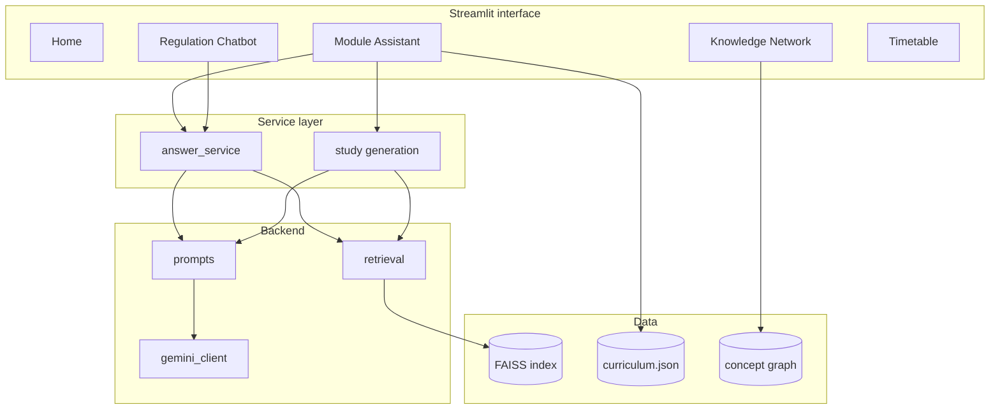
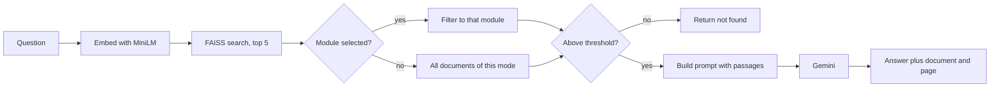
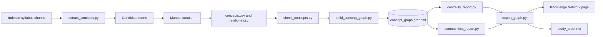

# AI & DS Knowledge Assistant — Report, Part 1

Draft of sections 1 to 5. Figures are given as Mermaid source; render them on
GitHub or redraw them in Word before submission.

---

## 1. Introduction

Students on the AI & Data Science programme are given the information they need
in the form of documents: a syllabus for each subject, broken into modules and
topics, and a separate academic regulations document covering attendance,
assessment, grading and examinations. The information is complete and it is
authoritative. It is also almost unusable in the moment a student needs it,
because answering "what is the minimum attendance to sit the exam" means
remembering which document holds the answer, finding it, and reading past the
parts that do not apply.

General-purpose chatbots appear to solve this and do not. Asked about a
specific institution's attendance rule, a large language model will produce a
fluent, plausible and frequently wrong answer, because the rule was never in
its training data. For an academic question the failure is worse than no
answer: the student cannot tell the difference.

This project builds a study assistant that answers only from the programme's
own documents and shows, under every answer, the document and page the answer
came from. On top of that retrieval layer it generates module summaries,
practice questions and quizzes from the same source material, and it analyses
the curriculum as a network of concepts to show which topics depend on which
others.

The work was carried out over twenty working days in three parallel tracks:
the retrieval and generation backend, the Streamlit interface, and the data
preparation and network analysis this report belongs to.

## 2. Problem formulation

The project addresses four distinct problems.

**P1 — Grounded question answering.** Given a question in natural language and
a corpus of institutional documents, return an answer that is derived only from
those documents, together with a citation precise enough to verify: document
name and page number. When the corpus does not contain the answer, the system
must say so rather than produce one.

**P2 — Scoped retrieval.** The same question can mean different things
depending on context. "What should I revise?" asked while studying Module 2 of
Artificial Intelligence should not retrieve from Machine Learning. The system
must restrict retrieval to a chosen subject and module when the user has
selected one, and search the regulations separately when the question is about
rules.

**P3 — Study material generation.** Summaries, practice questions and quizzes
must be generated from the retrieved passages rather than from the model's
prior knowledge, so that they stay on-syllabus and can be traced back to a
page.

**P4 — Curriculum structure.** A syllabus is presented as a flat list of
modules, but the concepts within it form a dependency structure: some must be
understood before others, and some span subjects. The project represents the
curriculum as a directed graph and uses social network analysis to identify
which concepts are foundational, which act as bridges between topics, and
which naturally cluster together.

### Constraints

- All documents are institutional PDFs of unknown and inconsistent formatting.
- The system must run on a single student laptop with no server and no GPU.
- Generation uses a free-tier API with a small daily request quota, so the
  design must minimise calls and degrade gracefully when the quota is reached.
- Answers must be verifiable by a student who does not trust the system.

## 3. Literature survey

**Retrieval-augmented generation.** Lewis et al. [1] introduced retrieval-
augmented generation, in which a language model is conditioned on passages
fetched from an external corpus at query time rather than relying on parameters
learned during training. The approach directly addresses the failure mode in P1:
the model is given the institution's text and asked to answer from it, so the
answer can be attributed to a source. This project follows that architecture,
with the simplification that retrieval and generation are not trained jointly —
an off-the-shelf embedding model and an off-the-shelf generative model are
composed.

**Dense retrieval and sentence embeddings.** Classical keyword retrieval fails
when a student's wording differs from the syllabus wording. Reimers and
Gurevych [2] showed that a Siamese BERT architecture can produce sentence
embeddings in which semantically similar sentences are close under cosine
similarity, making dense retrieval practical at sentence and paragraph scale.
The all-MiniLM-L6-v2 model from that line of work produces 384-dimensional
embeddings and runs acceptably on CPU, which satisfies the laptop constraint.

**Vector similarity search.** Johnson, Douze and Jégou [3] describe FAISS, a
library for efficient similarity search over dense vectors. At the scale of a
single programme's documents an exhaustive search would in fact be fast enough,
but FAISS gives a persistent on-disk index with a stable interface, which
matters more here than asymptotic performance.

**Centrality in networks.** Freeman [4] defined betweenness centrality as the
proportion of shortest paths between pairs of nodes that pass through a given
node, distinguishing it from simple degree. The distinction is exactly what P4
needs: a concept with many neighbours inside one module is locally important,
whereas a concept lying on the paths between modules is a bottleneck in the
learning sequence. Both measures are computed in this project and reported
separately, because they answer different questions.

**Community detection.** Blondel et al. [5] introduced the Louvain method, a
greedy modularity-optimisation algorithm that recovers community structure in
large networks in near-linear time. Applied to a concept graph it groups
concepts that are densely interlinked, which can then be compared against the
module boundaries the syllabus already defines — agreement validates the
relations, and disagreement points at genuine cross-module structure.

**Tooling.** Hagberg, Schult and Swart [6] describe NetworkX, the library used
here for graph construction, centrality and community detection.

### Gap

The retrieval literature treats the corpus as unstructured text and the network
literature treats the graph as given. An academic curriculum is both: a body of
documents and a dependency structure over the concepts those documents teach.
This project combines the two, using the same source documents to answer
questions and to derive the concept graph, so that a student can ask what a
topic means and also see what they needed to learn before it.

## 4. Methodology

### 4.1 Document preparation

PDFs are placed in `data/pdfs/` and described in a manifest that records, for
each file, whether it is a syllabus or a regulation document and which page
ranges belong to which module. Text is extracted page by page with PyMuPDF so
that page numbers survive extraction; a citation is only as trustworthy as the
page number attached to it.

The regulation document is additionally split into labelled sections —
attendance, assessment, grading, re-evaluation, backlogs — each with its page
range, so that regulation answers can be traced to a named rule.

The curriculum itself is held as structured JSON: year, semester, subject,
module, topics. A validation script checks it against the PDFs in the manifest
and reports missing subjects, inconsistent names and page ranges that do not
exist.

### 4.2 Indexing and retrieval

Extracted text is split into overlapping chunks of approximately 180 words with
30 words of overlap, each carrying its document, page, subject code and module
identifier. Chunks are embedded with all-MiniLM-L6-v2 and stored in a FAISS
index alongside a JSON file of the chunk metadata.

At query time the question is embedded with the same model and the five nearest
chunks are retrieved. Where the user has selected a module, a metadata filter
restricts candidates to that module's chunks, which implements P2. A minimum
similarity threshold discards weak matches.

### 4.3 Answer generation

Retrieved chunks are inserted into a prompt that instructs the model to answer
only from the supplied passages and to state that the information was not found
if the passages do not contain it. The response is returned with the list of
pages it drew on. The threshold and the refusal instruction work together: the
threshold removes obvious noise, and the prompt handles the harder case where a
passage is superficially similar but does not contain the answer.

Summaries, practice questions and quizzes use the same retrieval step with
different prompts and are cached per module, so that reopening a module costs
no API calls.

### 4.4 Concept graph construction

Candidate concepts are mined from the indexed syllabus chunks by frequency and
then curated by hand, because frequency alone cannot distinguish a concept from
a common word. The curated set is stored as two CSV files: concepts, each with
an identifier, display name, subject, module and aliases; and relations, each
being a directed edge of type `prerequisite` or `related-to` with a weight and
a justifying note.

A validation script checks that every concept belongs to a module that exists
in the curriculum, that identifiers are unique, and that no edge refers to a
concept that is not defined. The graph is then built in NetworkX, with
self-loops removed, duplicate edges merged keeping the stronger weight, and
contradictory pairs flagged for manual review.

### 4.5 Network analysis

Degree centrality and Freeman betweenness centrality [4] are computed over the
directed graph. Degree identifies densely connected concepts; betweenness
identifies the concepts that lie on the learning paths between topics, which
are reported as bridge concepts. Louvain community detection [5] is run on the
undirected projection, weighted by relation strength, and each community is
labelled by the module or subject that dominates it. Modularity is reported as
a measure of whether the structure found is real.

A topological sort of the prerequisite edges within each subject produces a
layered teaching order, which is the basis of the plain-language study guidance.

### 4.6 Evaluation

A test set of 50 questions was written against the source documents: 35 on the
syllabus and 15 on the regulations, of which 47 are answerable and 3 are
deliberately unanswerable. Each row records the question, its mode, the module
it belongs to, the keywords a correct answer must contain, and the document and
page the answer should cite.

An answer passes if it contains at least 60% of the expected keywords;
unanswerable questions pass only if the system refuses them. Retrieval is
scored separately by whether the expected page appears in the retrieved set,
which separates retrieval failures from generation failures — a distinction
that turned out to matter, as section 6 reports.

## 5. System design

### 5.1 Architecture

The interface never calls the backend directly. One function, `get_answer`,
separates them, and it is defined not to raise for expected problems: a missing
index, an empty question, no relevant passage or an API failure all return a
readable sentence and an empty source list. This was fixed at day 10 and left
unchanged, so the two tracks could proceed in parallel.

### 5.2 Answer pipeline

### 5.3 Concept graph pipeline

### 5.4 Data model

| File | Holds | Key fields |
|---|---|---|
| `curriculum.json` | the programme structure | year, semester, subject code and name, modules, topics |
| `documents.json` | which PDF covers what | file, document type, module page ranges |
| `regulations.json` | the regulation document split up | section title, topic, page range, text |
| `concepts.csv` | graph nodes | concept id, name, subject code, module id, aliases |
| `relations.csv` | graph edges | source, target, relation, weight, note |
| `test_questions.csv` | the evaluation set | question, mode, module, expected keywords, expected document and page |

### 5.5 Design decisions worth defending

**Page-level chunking.** Chunks never span a page boundary, which costs some
context at page edges but means every citation names exactly one page. A
citation a student cannot check is worth little.

**Two similarity thresholds.** Chat answers use a lower threshold than
summaries and questions. Short questions such as "what does PEAS stand for"
score low against any passage, and raising the threshold enough to exclude
irrelevant questions also excluded these; the prompt's refusal rule handles
them better. Summaries retrieve more broadly, so they keep the stricter
threshold to prevent unrelated pages entering the source list.

**Hand-curated relations.** Concepts are mined automatically but the edges
between them are written by hand with a justifying note. An automatically
inferred dependency would be a claim about the curriculum that nobody checked;
the graph is intended to be validated by a teacher, so every edge carries a
reason.

**Caching per module.** Generated content is stored against the module
identifier, so revisiting a module costs no API call. With a free-tier quota
this is the difference between a usable demonstration and one that stops
halfway.

---

### References

[1] P. Lewis et al., "Retrieval-Augmented Generation for Knowledge-Intensive
NLP Tasks," *Advances in Neural Information Processing Systems*, vol. 33, 2020.

[2] N. Reimers and I. Gurevych, "Sentence-BERT: Sentence Embeddings using
Siamese BERT-Networks," *Proceedings of EMNLP-IJCNLP*, 2019.

[3] J. Johnson, M. Douze and H. Jégou, "Billion-scale similarity search with
GPUs," *IEEE Transactions on Big Data*, vol. 7, no. 3, pp. 535–547, 2019.

[4] L. C. Freeman, "A Set of Measures of Centrality Based on Betweenness,"
*Sociometry*, vol. 40, no. 1, pp. 35–41, 1977.

[5] V. D. Blondel, J.-L. Guillaume, R. Lambiotte and E. Lefebvre, "Fast
unfolding of communities in large networks," *Journal of Statistical Mechanics:
Theory and Experiment*, P10008, 2008.

[6] A. A. Hagberg, D. A. Schult and P. J. Swart, "Exploring network structure,
dynamics, and function using NetworkX," *Proceedings of the 7th Python in
Science Conference*, pp. 11–15, 2008.
